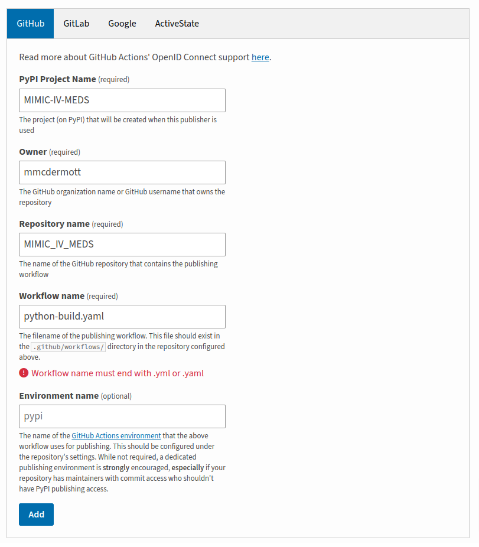

# ETL_MEDS_Template: A copier template for MEDS-Extract dataset ETL packages

[](https://github.com/Medical-Event-Data-Standard/ETL_MEDS_Template/actions/workflows/test-template.yaml)
[](https://github.com/Medical-Event-Data-Standard/ETL_MEDS_Template/actions/workflows/code-quality-main.yaml)
[](https://github.com/Medical-Event-Data-Standard/ETL_MEDS_Template#license)
[](https://github.com/Medical-Event-Data-Standard/ETL_MEDS_Template/pulls)
[](https://doi.org/10.5281/zenodo.17536399)

This is a [copier](https://copier.readthedocs.io/) template for **config-only
[MEDS-Extract](https://github.com/mmcdermott/MEDS_extract) dataset ETL packages**: pip-installable
Python packages whose entire substance is one MESSY configuration file (declaring where a dataset's
raw data lives and how its rows map to MEDS events) registered with MEDS-Extract's generic runner.
Once such a package is published, converting the dataset to [MEDS](https://medical-event-data-standard.github.io/)
is a single command:

```bash
pip install MIMIC-IV-MEDS # for example
meds-extract-run spec=MIMIC-IV output_dir=/path/to/output
```

MEDS-Extract (v0.7+) handles everything at run time — staged raw-data download, the canonical
extraction pipeline, and version-provenance stamping — so the per-dataset package contributes only
its configuration, plus the packaging, CI, and citation scaffolding this template generates.

## Creating a new dataset ETL package

With [uv](https://docs.astral.sh/uv/) installed:

```bash
uvx copier copy gh:Medical-Event-Data-Standard/ETL_MEDS_Template my_dataset_MEDS
```

Answer the prompts (dataset name, package name, author info, ...), then follow the printed next
steps:

```bash
cd my_dataset_MEDS
git init -b main
uv lock && uv sync --group dev
uv run pre-commit install
# Replace the toy example in src/<package>/event_configs.yaml, sumeds_rules.yaml and tests/, then:
uv run pytest tests/ -v
git add -A && git commit -m "Initial commit from ETL_MEDS_Template"
```

Commit everything the render produced, **including `uv.lock` and `.copier-answers.yml`** — the
latter is what lets `copier update` work later.

What you get, laid out like the current MEDS ETLs (Zigong_MEDS and PICdb_MEDS were the model):

- `src/<package>/event_configs.yaml`: the MESSY file (MEDS-Extract 0.9). Its `etl:` block declares the
  post-stages in the fleet's order: `sumeds_link_unit_siblings` → `sumeds_normalize_units` → the ETL's
  own post-stages → `sumeds_enrich`. Below it are the event-conversion tables (a toy example of three
  tables that shows the conventions: `_self` descriptions on every event, units in the code where an
  item has several), and a `sources:` block at the end (HTTP, PhysioNet or fsspec backends, with
  `${oc.env:...}` credential interpolation).
- `src/<package>/sumeds_rules.yaml`: the [suMEDS](https://github.com/rvandewater/suMEDS) enrichment rules
  (a toy ICD-10-CM rule).
- A `pyproject.toml` registering the spec under `MEDS_extract.pipelines` and the rules under
  `sumeds.rules`, both as the dataset name, so `meds-extract-run spec=<dataset name>` finds the spec
  and its `sumeds_enrich` stage finds the rules. It also pins MEDS-Extract and suMEDS, and has one
  `dev` dependency group and the fleet's ruff settings.
- Tests:
  - `tests/conftest.py` writes a tiny synthetic input;
  - `tests/e2e_synthetic_test.py` runs the ETL over it;
  - `tests/test_config.py` checks the spec;
  - `tests/test_sumeds_rules.py` and `tests/test_run_with_enrichment.py` are suMEDS's shared contract
    tests (`sumeds.testing.contracts`), offline;
  - if your dataset has an open demo release, an end-to-end test against it.
- CI:
  - tests;
  - a **synthetic-ETL** workflow that generates raw data from the spec with MESSY-synth 0.1.1 and
    runs the ETL over it;
  - a **summary-stats** workflow that warns when the ETL changes but its baseline does not;
  - pre-commit code quality;
  - a tag-triggered PyPI publishing workflow (see [PyPI setup](#pypi) below).
- `scripts/summary_stats.sh` and `tests/regression/policy.yaml`, which regenerate and compare a
  [meds_summary_stats](https://github.com/Medical-Event-Data-Standard/meds_summary_stats) baseline of
  the full release.
- A seeded `README.md` (with a `## Breaking changes` section), `CITATION.cff` and an MIT license.

### What this template does *not* cover

Datasets that need custom *code* — pre-MEDS wrangling beyond what MESSY `_table.cols`/`_table.joins`
transformations can express (e.g. archive unpacking or complex reshaping) — are out of scope for
the config-only shape. For those, write the pre-processing separately and run the standalone route
(`meds-extract-download` + `MEDS_transform-pipeline`) documented in
[MEDS-Extract](https://github.com/mmcdermott/MEDS_extract).

## Updating an existing package from the template

Template improvements (CI fixes, packaging conventions, new MEDS-Extract pins) propagate to
generated repositories via copier's update mechanism. In your dataset repository, with a clean git
tree:

```bash
uvx copier update
```

Review the diff, resolve any conflicts (your spec, rules, tests, `README.md` and `CITATION.cff` are
never overwritten), and commit. Updates are pinned to this template's git tags, released per
[PEP 440](https://peps.python.org/pep-0440/) ordering.

## External services for your generated package

### PyPI

1. Go to [PyPI](https://pypi.org/) and make an account or log in as needed.
2. In your account settings, open the "Publishing" settings.
3. Set up a new "Trusted Publisher" for your GitHub repository (e.g., see the image below). Ensure
   the package name matches your `pyproject.toml`, and the workflow filename is
   `python-build.yaml`.
4. Then `git tag 0.1.0 && git push origin 0.1.0` publishes that version to PyPI and creates a
   signed GitHub release.

Example trusted publisher set-up:


### Zenodo

[Zenodo](https://zenodo.org/) can archive your releases and assign a citable DOI: follow
[GitHub's guide](https://docs.github.com/en/repositories/archiving-a-github-repository/referencing-and-citing-content),
then record the DOI in your `README.md` and `CITATION.cff`.

## Breaking changes

Changes that need action in a package generated from an earlier template version, newest first.

### Unreleased (after 0.1.0)

- **The spec moved** from `src/<package>/configs/event_configs.yaml` to
  `src/<package>/event_configs.yaml`, where most MEDS ETLs keep it. The `MEDS_extract.pipelines`
  entry point changed from `<package>.configs:event_configs.yaml` to `<package>:event_configs.yaml`.
  Before `copier update`, move it and drop the `configs` package:

  ```bash
  pkg=your_package # the package name, as in src/
  git mv "src/$pkg/configs/event_configs.yaml" "src/$pkg/event_configs.yaml"
  git rm "src/$pkg/configs/__init__.py"
  ```

- **MEDS-Extract 0.9 and suMEDS.** The dependencies are now `meds-extract[download]>=0.9.1,<0.10` and
  `sumeds>=0.6.8,<0.7`, and the `dev` group adds `sumeds[testing]>=0.6.8,<0.7` for the contract tests. The spec must declare `etl.post_stages` (`sumeds_link_unit_siblings`,
  `sumeds_normalize_units`, your own, `sumeds_enrich: {rules: <dataset name>}`), and the package
  must ship `sumeds_rules.yaml`, registered under `sumeds.rules`. The new tests check both.

- **One dependency group.** The `tests` group is gone: pytest is in `dev`, so use
  `uv sync --group dev`. The setup action's default group is `dev`.

- **pre-commit** now uses ruff (lint and format) instead of black, isort, autoflake, pyupgrade and
  flake8: the configuration most MEDS ETLs share.

- `tests/test_configs.py` is replaced by `tests/test_config.py`.

## Template development

```bash
uv sync
uv run pytest tests/ -v # renders the template and tests the rendered project
uv run pre-commit run --all-files
```

The template payload lives under [`template/`](template); questions and behavior are configured in
[`copier.yml`](copier.yml). Releases are git tags: tag the repository (PEP 440-ordered) whenever a
change should propagate to generated packages via `copier update`.
